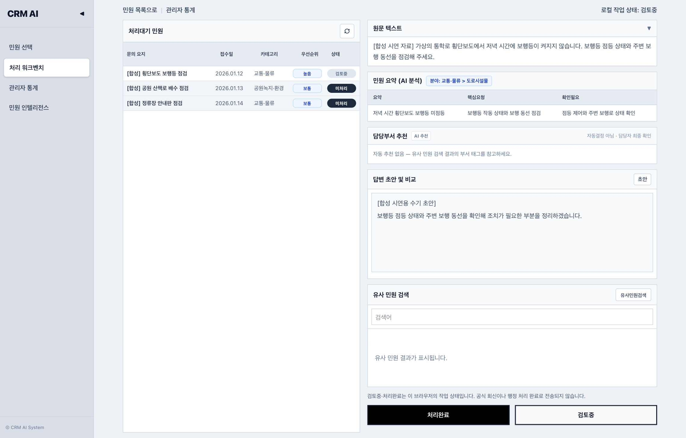

# 민원 워크벤치

민원 담당자가 유사 사례와 근거를 확인하고 답변 초안을 검토·편집하는 로컬 업무 도구입니다. 관제 화면에서는 반복 민원 후보와 지역 이슈를 살펴보고, 자료 출처와 저장 조회·새 분석의 구분을 확인할 수 있습니다.

| 살펴볼 내용 | 안내 |
| --- | --- |
| **시연 보기** | [민원 선택부터 근거 확인과 초안 편집까지](frontend/WORKBENCH_E2E_DEMO.md) |
| **로컬 실행** | [자산 준비, 사전 점검, API·화면 시작](docs/30_manuals/local_dev_runbook.md) |
| **검증 결과** | [확인된 동작과 평가 범위](docs/README.md#검증-범위) |

*실제 워크벤치에서 합성 민원과 사전에 작성한 요약을 조회하고, 같은 브라우저에서 수기 초안과 검토 상태를 복원한 화면입니다.*

## 화면에서 하는 일

- **민원 선택·처리**: 민원을 골라 요약을 보고, 유사 민원의 근거와 답변을 확인한 뒤 초안을 편집합니다. 초안과 개별 민원의 작업 상태는 현재 브라우저에 저장됩니다.
- **관제·중복 검토**: 이슈 경보, 행정 인사이트, 중복 후보를 살펴봅니다. 화면에 기록된 자료 출처와 생성 방식을 함께 표시합니다.
- **관리자 통계**: 지역·분야별 민원 현황을 조회합니다.

## 실행에 필요한 자료

저장소에서 코드와 문서를 확인할 수 있습니다. 전체 로컬 시연에는 별도로 준비한 검색 인덱스·관제 DB·시연 케이스와 설치된 로컬 모델이 필요합니다. 실행 안내에는 복사할 자산, 모델 위치, 사전 점검과 화면 주소가 있습니다. [독립 실행 안내](docs/30_manuals/local_dev_runbook.md)

[프로젝트 문서 지도](docs/README.md) · [자료와 개인정보 처리](docs/20_domains/complaint_intelligence/pii_safety_policy.md)
